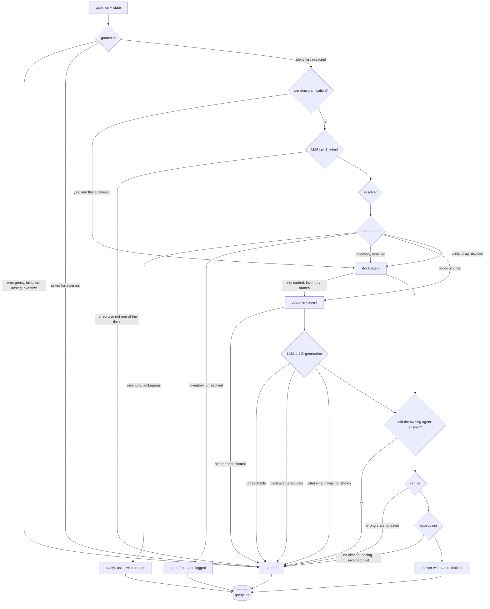

# Low-level design

> Module paths are relative to [`clinic_retrieval/`](../clinic_retrieval); `tests/`, `scripts/` and `data/` are at the repo root.

What each piece does, what it hands to the next one, and what holds whether or
not anyone is watching. Why each choice was made is in
[DECISIONS.md](DECISIONS.md); what a deadline would change is in
[TRADEOFFS.md](TRADEOFFS.md); how the orchestrator, memory, tools and
governance work is in [ORCHESTRATION.md](ORCHESTRATION.md).

---

## 1. Components

| Module | Responsibility | Depends on |
|---|---|---|
| `core.py` | The types everything passes around, and the paths to the data | nothing |
| `lang.py` | Devanagari to Latin, the normalised and skeleton keys, word splitting that survives Devanagari, stopwords in three forms, input-form detection | nothing |
| `llm.py` | The one model, called twice per question, over an OpenAI-compatible endpoint. Returns a parsed object or `None` | nothing |
| `retrieval/embed.py` | `SentenceEmbedder`: `multilingual-e5-small` with query and passage prefixes, carrying its own measured floor | nothing |
| `retrieval/lexical.py` | `Bm25` over transliteration keys, scored against the ceiling the query could reach so one floor works across questions | `core`, `lang` |
| `retrieval/index.py` | Corpus loading, heading chunking, the state filter, and `Hybrid`: both retrievers, reciprocal rank fusion, and the floor test | `core`, `retrieval/*` |
| `generation.py` | The prompt, the numbered context, and mapping the model's source numbers back to chunk ids | `core`, `llm` |
| `guardrails.py` | Input and output screening. A leaf module on purpose | `core` |
| `agents/drugs.py` | The resolver (alias, key, trigram-blocked fuzzy, three outcomes) and the stock table that joins a code to this clinic's count | `core`, `lang` |
| `agents/intent.py` | `read`: the model's three-way label and the drug name it saw. `plan`: pure, which agents handle this, and which one owns the answer | `core`, `agents/drugs`, `llm` |
| `agents/docs.py` | The document agent: retrieve, apply the floors, generate, check the citation | `core`, `retrieval`, `generation`, `llm` |
| `tools.py` | The three declared capabilities, each with parameters, the data it may read, and a recorded call | `agents/*`, `retrieval`, `llm` |
| `session.py` | The pending clarification, bound to a clinic, TTL ten minutes, bounded and evicted | nothing |
| `security.py` | API keys to clinic scope, and the actor on the audit record | nothing |
| `agents/orchestrate.py` | The pipeline: guards, memory, intent, resolver, router, agents, verifier, output guards, escalation, logging | everything below it |
| `analytics.py` | Query log and rollups, the four RAGAS metrics, two gold-set runners (retrieval alone, and the whole stack), the drug-threshold runner | `core`, `lang`, `llm`, `retrieval` |
| `models.py` | Request and response bodies | pydantic |
| `deps.py` | Process-wide singletons: the index, the model client, one orchestrator per state, the log | `agents`, `retrieval`, `analytics` |
| `routers/` | `health.py`, `ask.py`, `analytics.py`. One `APIRouter` each | `deps`, `models` |
| `app.py` | The app: lifespan, the three routers, the static client | `routers`, `deps` |

`llm.py` talks HTTP with `urllib` from the standard library, so the model
client adds no dependency. Only `app.py`, `routers/`, `models.py`, `deps.py`
and `retrieval/embed.py` import anything outside it.

---

## 2. Flow

```
                         question + state
                                │
                       ┌────────▼────────┐
                       │  guards (in)    │  emergency ─┐
                       │  guardrails.py  │  injection  │
                       └────────┬────────┘  dosing     ├──► handoff
                                │           oversize ──┘
                      redact phone / aadhaar
                                │
                        wants a person? ──────────────────► handoff, no model call
                                │
                       ┌────────▼────────┐
                       │  memory         │  a pending clarification, answered
                       │  session.py     │  by number or by name ──► stock
                       └────────┬────────┘
                                │
                       ┌────────▼────────┐
                       │  LLM call 1     │  {"intent": ..., "drug": ...}
                       │  intent.py      │  inventory | policy | clinic
                       └────────┬────────┘  anything else ──► handoff
                                │
                       ┌────────▼────────┐
                       │  resolver       │  phrase 1.00  part 0.90  key 0.88
                       │  drugs.py       │  fuzzy ratio, trigram-blocked
                       └────────┬────────┘  accept 0.86, margin 0.05
                                │
                       ┌────────▼────────┐
                       │  router (pure)  │  label + resolution ──► agents, owner
                       │  intent.plan    │
                       └──┬───────────┬──┘
                          │           │
            inventory ────┘           └──── policy | clinic
                 │                              │
        ┌────────▼────────┐            ┌────────▼────────────────┐
        │  stock agent    │            │  document agent         │
        │  drugs.py       │            │  docs.py                │
        │  owner on this  │            │  owner on this branch   │
        │  branch         │            │                         │
        │                 │            │  state filter (hard)    │
        │  count for      │            │  dense + BM25, RRF      │
        │  this clinic    │            │  top-k = 4              │
        │     or          │            │  either floor cleared? ─┼─► no ──► handoff
        │  not carried    │            │    dense    0.855       │
        │     ├─► adds    │            │    lexical  0.055       │
        │     │   docs    │            │                         │
        │     │   with    │            │  ┌───────────────────┐  │
        │     │   the     │            │  │  LLM call 2       │  │
        │     │   indent  │            │  │  generation.py    │  │
        │     │   query   │            │  │  cleared chunks   │  │
        │     │           │            │  │  only, numbered   │  │
        │     │           │            │  └─────────┬─────────┘  │
        │     │           │            │   no reply ──► handoff  │
        │     │           │            │   declined ──► handoff  │
        │     │           │            │   cited something it    │
        │     │           │            │   was not shown ──► handoff
        └─────┴───────┬───┘            └────────┬────────────────┘
                      │                         │
                      └───────────┬─────────────┘
                     owner answered? ──► no ──► handoff
                                  │
                            ┌─────▼─────┐
                            │ verifier  │  wrong state ──► handoff
                            │           │  undated     ──► handoff
                            └─────┬─────┘
                       ┌──────────▼──────┐
                       │  guards (out)   │  no citation      ─┐
                       │  guardrails.py  │  dosing language   ├──► handoff
                       │                 │  invented digit    │
                       │                 │  pii echo         ─┘
                       └────────┬────────┘
                          stale ► flag, not block
                                │
                       ┌────────▼────────┐        ┌──────────────────┐
                       │ answer          │        │ query log        │
                       │ text            │───────►│ per form         │
                       │ citations+dates │ every  │ per intent       │
                       │ flags, score    │outcome │ unresolved names │
                       └─────────────────┘        └──────────────────┘
```



---

## 3. Four sequences

**A scheme question.** `Orchestrator.handle` → `screen_input` passes → no
pending clarification → `read` returns `Intent("policy", "")` →
`resolve_drug` finds nothing → `plan` returns `("docs",)` with `owner="docs"`
→ `Clinic.ask` → `Hybrid.search(query, state, 4)` scores only the chunks
`visible(state)` returns, fuses the two shortlists → at least one hit
`cleared` → `generation.write` sends the cleared chunks numbered → the reply's
source numbers map back to chunk ids → every id was shown → `_verify` →
`screen_output` → `Answer` with one dated source → log.

**An availability question.** `read` returns `Intent("inventory", "amoxicillin")`
→ the resolver is given the extracted name rather than the whole question →
one match above 0.86 with a clear margin → `plan` returns `("stock",)` with
`owner="stock"` → `check_stock` → a line and a counted timestamp. No
retrieval, no second model call, and the trace shows one model call.

**A composite question.** `read` returns `Intent("clinic", "amoxicillin")`, so
`plan` returns `("stock", "docs")` with `owner="docs"`. The stock agent
produces a line and a counted timestamp; the document agent retrieves against
the user's own words, generates, and produces a citation with a document date.
The orchestrator joins the text, concatenates citations, and the verifier sees
both. Two entries in `sources`, each with its own date. If retrieval finds
nothing above either floor the whole answer is refused, because the document
agent owns this branch and the stock count is not an answer to the question
that was asked.

**A drug this clinic does not carry.** The resolver resolves, `check_stock`
returns `None`, and that is an answer rather than a failure. On the
`inventory` branch only, the orchestrator appends the document agent and
rewrites the retrieval query to the stock-out procedure, so the indent steps
come with the answer. On any other branch the query is left alone: rewriting it
would apply the retrieval floor to a question nobody asked.

**A refusal.** Any of: a guard blocks before the model is called; the model
cannot be reached or does not return one of the three labels; the router sees
an availability question naming a drug the formulary does not have; neither
retrieval floor is cleared; the model reads the sources and declines; the model
cites a chunk it was not shown; the owning agent produced nothing; the verifier
rejects a cross-state citation; an output guard finds a digit with no source.
Each produces a `Handoff` carrying the `Reason` and a note, and each appears in
the trace.

---

## 4. Data contracts

```python
Chunk(id, doc, title, text, state, kind, updated)      # frozen
Drug(code, generic, cold_chain, aliases)               # the national formulary
Candidate(code, name, score, how, term)                # how: phrase, part, key, fuzzy
Resolution(outcome, best, candidates)                  # resolved, ambiguous, unresolved
StockRecord(drug, on_hand, clinic, counted)            # None means not carried here
Hit(chunk, dense, lexical, cleared, retriever)         # frozen; .score is the cosine
Answer(text, citations, sources, state, score, flags)  # frozen
Handoff(reason, state, best_score, note, considered)   # frozen
Clarify(asks, options, state, reason)                  # understood, needs one word
Result = Answer | Handoff | Clarify                    # a union, not an exception

Intent(label, drug)                                    # what the model read
Route(agents, drug, why, label, owner, reason, resolution)
Written(text, citations, insufficient)                 # what the model wrote
Tool(name, description, params, reads, run)            # a declared capability
ToolCall(name, args, summary)                          # one recorded call
Pending(kind, options, codes)                          # a question awaiting a reply
Session(id, state, created, touched, turns, pending)   # ten minutes, one clinic
Caller(id, states)                                     # who asked, and about where
Step(agent, detail)                                    # one trace line
Response(result, trace, route, session)                # what the orchestrator returns

Screen(text, trips, blocked)                           # a guard verdict
Trip(guard, action, detail)                            # action: block, redact, flag

Unresolved(question, state, nearest)                   # the formulary feedback loop
QueryRecord(form, state, intent, agents, answered, reason, score, ms,
            flags, redactions, actor, tools)
```

`Hit` carries two numbers because a cosine and a normalised BM25 sum cannot be
compared with each other or share a threshold. `cleared` is the one question a
caller has to ask, and the index answers it so no caller has to know there are
two retrievers. `Hit.score` is the cosine, because that is the figure the rest
of the world quotes.

`Route.owner` names the agent whose refusal refuses the whole answer.

`sources` is `list[tuple[str, str]]`: a chunk id or `stock:<clinic code>`,
paired with the date that source carries. Every answer has at least one.

Refusing is a return value, not an exception, so every caller has to decide
what to do about it. `Written` separates "the model said no" from "the model
could not be reached", because one is a corpus gap and the other is an outage.

---

## 5. Invariants, and the test that pins each one

| Invariant | Pinned by |
|---|---|
| A clinic never sees another state's chunk, and the filter has something to hold back | `tests/test_retrieval.py` |
| Nothing in the gold set is answered from the wrong document, in any form | `test_nothing_in_the_gold_set_is_answered_from_the_wrong_document` |
| Zero cross-state citations over the whole gold set | `test_the_gold_set_answers_from_the_right_document_in_every_form` |
| Every figure in an answer appears in its cited chunk, compared by value | `test_every_figure_in_an_answer_comes_from_its_cited_chunk` |
| An out-of-scope question clears neither floor | `test_an_out_of_scope_question_clears_neither_floor` |
| The encoder alone cannot separate romanised Hindi from out-of-scope | `test_the_encoder_alone_would_refuse_it` |
| Romanised Hindi is carried by the lexical retriever, not the encoder | `test_romanised_hindi_is_answered_by_the_lexical_retriever` |
| A label the system does not have is never guessed | `test_a_label_the_system_does_not_have_is_not_guessed` |
| A model that is down escalates rather than answering | `test_a_model_that_is_down_escalates_rather_than_answering` |
| The model declining is its own reason, not a retrieval miss | `test_a_model_that_declines_is_not_overridden` |
| A citation the model was not shown is refused | `test_a_citation_the_model_was_not_shown_is_refused` |
| A figure the sources do not contain is blocked | `test_a_figure_the_sources_do_not_contain_is_blocked` |
| A dose the model writes is blocked whatever the question was | `test_a_dose_the_model_writes_is_blocked` |
| A live-stock question is never answered from a document | `test_stock_question_is_not_answered_from_documents` |
| An availability question spends no generation call | `test_stock_question_is_not_answered_from_documents` |
| Asking for a person spends no model call at all | `test_asking_for_a_person_spends_no_model_call` |
| An unlisted drug escalates without the document agent running | `test_unlisted_drug_escalates_instead_of_retrieving` |
| Nothing resolves to the wrong drug anywhere in the usable threshold band | `test_nothing_resolves_wrongly_anywhere_in_the_usable_band` |
| A name that fits two drugs asks instead of picking one | `test_an_ambiguous_name_asks_instead_of_guessing` |
| A known drug this clinic does not carry is answered, with the procedure | `test_a_known_drug_this_clinic_does_not_carry_is_answered` |
| An unresolved name reaches the curation list | `test_an_unresolved_name_is_recorded_for_the_formulary_owner` |
| Emergency outranks the dosing guard | `test_emergency_outranks_the_dosing_guard` |
| Composed answers are re-checked for state | `test_verifier_catches_a_cross_state_citation` |
| Answering a clarification needs no model call | `test_answering_a_choice_spends_no_model_call` |
| A session never reaches another clinic, and expires | `test_a_session_does_not_reach_another_clinic` |
| Metrics are reported per input form and never pooled | `test_forms_are_never_pooled` |
| The two context metrics stay measurable with the model switched off | `test_the_two_context_metrics_need_no_model` |
| Retrieval is scored separately from generation, so one cannot flatter the other | `analytics.retrieval_tally` vs `analytics.gold_tally` |

---

## 6. Failure taxonomy

| `Reason` | Raised by | What the client shows |
|---|---|---|
| `EMERGENCY` | input guard | refused, goes to a person, no model call |
| `UNSAFE_INPUT` | input guard, output guard | refused: injection, oversize, or an identifier in the answer |
| `CLINICAL_ADVICE` | input guard, output guard | refused: dosing or diagnosis, asked or written |
| `OUT_OF_SCOPE` | orchestrator | refused: asked for a person |
| `MODEL_UNAVAILABLE` | orchestrator, document agent | refused: the model did not answer. An outage, not a corpus gap |
| `UNCLEAR_INTENT` | orchestrator | refused: the model answered with something that is not one of the three labels |
| `NOT_IN_FORMULARY` | router | refused: nothing in the formulary fits the name, and the name is logged |
| `AMBIGUOUS_DRUG` | router | a question with the options, not a refusal |
| `BELOW_FLOOR` | document agent | refused, with the best score in each space against each floor |
| `MODEL_ABSTAINED` | document agent | refused: retrieval cleared, the model read the sources and declined |
| `NO_RELEVANT_CONTEXT` | document agent, verifier, orchestrator | refused: nothing visible to search, or the owning agent produced nothing |
| `WRONG_STATE` | verifier | refused, and this one should never be seen in production |
| `UNGROUNDED_CITATION` | document agent, output guard | refused: a citation outside the set the model was shown, or an invented digit |
| `STALE_SOURCE` | output guard | a flag on an answer, never a block |

`MODEL_ABSTAINED` and `BELOW_FLOOR` are deliberately separate. The first says
the corpus had something and the model would not use it, which is a prompt or a
model problem. The second says the corpus had nothing, which is a curation
problem. Averaging them would hide whichever one is actually happening.

---

## 7. Config and tunables

| Where | Name | Value | Notes |
|---|---|---|---|
| `embed.py` | `SentenceEmbedder.min_score` | 0.855 | measured for that space, band 0.840 to 0.871 |
| `index.py` | `lexical_floor` | 0.055 | measured for that space, band 0.011 to 0.102 |
| `index.py` | `RRF_K` | 60 | the usual constant; it flattens the tail, not the top |
| `lexical.py` | `K1`, `B` | 1.2, 0.75 | standard BM25 saturation and length normalisation |
| `lang.py` | key weights | 1.0 / 0.6 / 0.5 | surface, Latin, skeleton. Query side only |
| `docs.py` | `top_k` | 4 | candidates fused and considered |
| `drugs.py` | `ACCEPT` | 0.86 | measured, band 0.84 to 0.88 |
| `drugs.py` | `MARGIN` | 0.05 | measured, band 0.03 to 0.08. Closer than this is ambiguous |
| `drugs.py` | `_MIN_KEY` | 3 | shorter transliteration keys are noise, not tolerance |
| `session.py` | `TTL_SECONDS` | 600 | about one counter conversation |
| `session.py` | `MAX_SESSIONS` | 500 | a clinic has tablets, not thousands of users |
| `guardrails.py` | `MAX_CHARS` | 500 | also enforced by the API model, so an oversize body is a 422 |
| `guardrails.py` | `STALE_AFTER_DAYS` | 365 | annual revision cycle |
| env | `LLM_BASE_URL` | `http://127.0.0.1:11434/v1` | any OpenAI-compatible server: Ollama, vLLM, hosted |
| env | `LLM_MODEL` | `qwen2.5:3b-instruct` | one model for both calls |
| env | `LLM_TIMEOUT` | 30s | one attempt, no retry |
| env | `CLINIC_API_KEYS` | unset | `secret:label:state\|state`, comma separated. Unset means open, reported at `/health` |
| `deps.py` | caches | index once, model client once, one orchestrator per state | the stock table is per clinic |

Both model calls use `temperature: 0` and ask for `response_format:
json_object`, and the reply is parsed by finding the first JSON object in it,
because a small instruct model wraps JSON in prose often enough to plan for.

---

## 8. Extension points

Each of these is a new class or one insertion, not a change to the flow.

**The model.** `llm.py` is one class with `chat`, `json` and `reachable`.
Swapping Ollama for vLLM is `LLM_BASE_URL`; swapping the model is `LLM_MODEL`.
A model that supports native tool calling becomes a new caller around the same
`Toolbox`, whose schema `GET /tools` already serves.

**The embedder.** `retrieval/embed.py` is one class with `embed`,
`embed_document`, `name` and `min_score`. The floor travels with the space, so
swapping means re-running `scripts/evaluate.py` and nothing else.
`embed_document` exists because e5 was trained with separate query and passage
prefixes and loses accuracy without them.

**A third retriever.** `Hybrid.search` fuses a list of shortlists. A new one
contributes a shortlist and a floor, and `_hit` gains a clause. The fusion is
reciprocal rank, which needs no score calibration between retrievers.

**A re-ranker.** Between the fusion and the floor test in `Clinic.ask`. It
reorders `list[Hit]` and the floor then applies to the reordered top.

**A vector store.** `Hybrid.search` is the only thing that scans. `sqlite-vec`
replaces the dense loop, an FTS5 table replaces the BM25 loop, and
`visible(state)` becomes a WHERE clause in both.

**The formulary.** `data/formulary/formulary.json` is a list of codes, generic
names and aliases. The real national list drops in as-is: the trigram index
build is linear in formulary size and query cost is set by the candidate block,
not by the row count. Strengths and dosage forms would need another level in
the key, which is why the resolver returns candidates rather than one code.

**A fourth intent.** `read` validates against `LABELS` and `plan` branches on
the label. A new one is an entry in both, plus a prompt line. It needs a
reason: a different data source or different permissions, not a different
topic.

**A third agent.** `plan` returns a tuple of names and an owner; `handle` fans
out on membership. Adding one is a branch in the router and a block in the
orchestrator.

---

## 9. Performance

Index build is 16 chunks and happens once at startup, inside the FastAPI
lifespan hook rather than on the first request. Retrieval is a 384-float dot
product plus a BM25 sum per visible chunk, so it sits around 3ms. Memory is the
corpus, one vector per chunk, and the BM25 posting lists.

The embedding model is roughly 500MB resident including torch, and its query
cost is one forward pass. Startup is about 14 seconds: torch imports, the model
loads, the corpus is encoded, all inside the lifespan hook.

The generative model dominates everything else. Two calls per question at
temperature 0, the first with a short reply and the second with at most 300
tokens, against a 3B-class model: expect a few hundred milliseconds to a couple
of seconds on clinic hardware, which is why the intent call is skipped whenever
it can be (a clarification answered by number, a request for a person) and the
generation call is skipped entirely on the inventory branch. A 4-bit 7-8B model
plus this encoder is still inside 16GB.

---

## 10. Test map

```
tests/conftest.py         the scripted model, and the shared index fixture
tests/test_lang.py        tokenisation survives Devanagari, keys collide
tests/test_retrieval.py   state filter, both floors, the gold set, why two retrievers
tests/test_agents.py      resolver, intent reading, routing, the whole pipeline,
                          what happens when the model misbehaves, tools, memory
tests/test_guardrails.py  block, redact and flag, and guard precedence
tests/test_analytics.py   per-form metrics, the gold tally, abstain rates, the log
tests/test_api.py         endpoints, auth, sessions, validation, the client
tests/test_ingest.py      a downloaded document becomes loadable chunks
```

165 tests. `pyproject.toml` points pytest at `tests/`, so `python -m pytest -q`
from the root runs everything. No test calls a model server: `tests/conftest.py` holds a
scripted stand-in that labels questions from a keyword table and quotes its
source back, so a failing test is a change in the pipeline rather than in a 3B
model's mood. What that stand-in cannot test, generation quality, is measured separately
against a served model by `scripts/live_eval.py`, with the results in
[EVALUATION.md](EVALUATION.md).

---

## 11. What production needs that this does not have

Named so nobody has to discover them.

- The intent step measured against a labelled set of real questions, with a
  confusion matrix. Right now its correctness is asserted on scripted labels
  and the three-way distinction is argued, not measured
- Faithfulness and relevance measured against a served model, which needs a
  model served
- `MuRIL` benchmarked against e5, since it is trained on transliterated text
- A relative-margin floor for the dense space, where top-1 to top-2 gaps are
  0.001 to 0.014
- A prompt regression set, so a prompt edit cannot quietly change behaviour
- Rate limiting at a gateway rather than here
- Durable analytics and audit retention. The query log is in-process and dies
  on restart, and a retention period has to be agreed with the clinic network
- Keys per device rather than per clinic, and rotation
- Sessions in Redis rather than in process
- A corpus sync path, with supervisor conflict review
- The third state, which is corpus rather than design
- Strength and dosage-form resolution, which the real formulary will force
- A curation UI for the unresolved list, which is currently a JSON endpoint
- A gold set written by the people who answer these questions today
