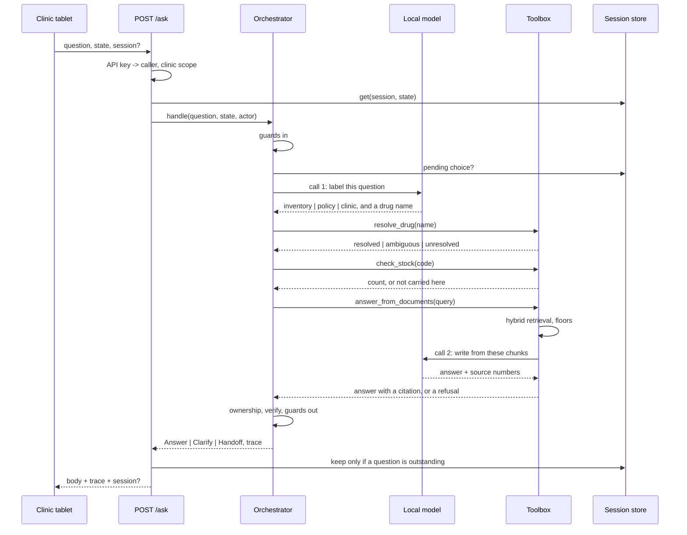

# Orchestration, memory, tool use, and governance

> Module paths are relative to [`clinic_retrieval/`](../clinic_retrieval); `tests/`, `scripts/` and `data/` are at the repo root.

Four questions any agentic system has to answer, answered against the code
rather than in general. Design detail is in [LLD.md](LLD.md), the choices in
[DECISIONS.md](DECISIONS.md), and what was given up in
[TRADEOFFS.md](TRADEOFFS.md).

---

## 1. How the orchestrator works

One sequential pipeline, hand-written, in `agents/orchestrate.py`. Eight
stages, and every one of them can end the turn. Two of the eight are model
calls; the other six are code.

```
         ┌──────────────────────────────────────────────────────────┐
         │  Orchestrator.handle(question, session, actor)           │
         └──────────────────────────────────────────────────────────┘
                                   │
  1. guards in      guardrails.screen_input
                    emergency ▸ injection ▸ dosing ▸ oversize ──────────► handoff
                    phone / aadhaar ▸ redacted, then carry on
                    asked for a person ──────────────────────────────────► handoff
                                   │                                  (no model call)
  2. memory         session.pending?  ──── matched ────► route = (stock, code)
                    (the one thing remembered)                        (no model call)
                    not matched ▸ cleared, treated as new
                                   │
  3. read      ◆    LLM call 1: {"intent": ..., "drug": ...}
     the question   inventory │ policy │ clinic
                    anything else, or no reply ─────────────────────────► handoff
                                   │
  4. resolve        tool: resolve_drug(the extracted name, or the question)
                    resolved │ ambiguous ──► clarify, held in session
                             │ unresolved + inventory ──► handoff + logged
                                   │
  5. route          agents.intent.plan(intent, resolution)   ← pure, no I/O
                    (stock,) │ (docs,) │ (stock, docs) │ (escalation,)
                    and an owner: the agent whose refusal refuses the answer
                                   │
  6. agents         tool: check_stock(code)
                      not carried here, on the inventory branch
                      ──► re-plan, append docs, ask it the indent procedure
                    tool: answer_from_documents(query)
                      neither floor cleared ──────────────────────────────► handoff
                      ◆ LLM call 2: write from the cleared chunks only
                        no reply ▸ declined ▸ cited what it was not shown ─► handoff
                                   │
  7. ownership      did the owning agent produce anything? ──── no ──────► handoff
                                   │
  8. verify         state and dating re-checked where answers compose
                    guardrails.screen_output
                      no citation ▸ dosing ▸ invented digit ─────────────► handoff
                      stale source ▸ flagged, not blocked
                                   │
                    Answer │ Clarify │ Handoff   +   trace   +   log record
```



**The model reads and writes. It does not decide.** Call 1 picks a data source
from three. Call 2 writes a sentence from text it was handed. Between and after
them, every decision is code: which drug was named, whether either retrieval
floor was cleared, whether the citation is one of the chunks shown, whether
every digit came from a source, whether the state matches. That split is what
keeps the failure modes enumerable and the eval reproducible.

**Two calls, one model.** A clinic box holds one set of weights; a second model
for classification would cost memory a 16GB clinic box does not have. The intent prompt
is short and asks for two fields, so the first call is cheap compared with the
second.

**Both model calls are skippable, and the code skips them.** Asking for a
person never reaches the model. Answering a clarification by number never
reaches it either. An availability question makes the first call and not the
second, because a stock count is a row and does not need writing.

**Three outcomes, as equals.** `Answer`, `Clarify` and `Handoff` are a union in
`core.py`, so a caller cannot forget one. Refusing and asking are return values,
not exceptions, because in a clinic both are correct more often than failure is.

**Why hand-written.** Eight stages, no cycles, nothing to persist mid-run. A
graph framework earns its place when a run can pause and resume, which happens
the day a human escalation becomes a step rather than an exit. The boundaries
are what matter and they port.

**One agent's finding can change the plan.** If the stock tool reports a drug
the formulary knows and this clinic does not carry, the orchestrator appends the
document agent and asks it the procedure question rather than the user's words.
That re-plan appears in the trace as a second `router` line. It happens only on
the inventory branch: rewriting any other question's query would put the
retrieval floor on a question nobody asked.

**One agent's refusal can refuse the answer.** Each branch names an owner. On a
procedure question the document agent owns it, so a stock count in hand does not
rescue an answer whose procedure nobody could find.

---

## 2. State management and memory

**One thing is remembered: a question the system asked and has not had answered.**
Nothing else. `session.py` is forty lines and that is the whole feature.

```
turn 1   "is iron available"
         resolver ▸ ambiguous between 2
         Clarify(options)                     ──► session.pending = drug_choice
                                                  (options, codes)  TTL 10 min

turn 2   "iron sucrose"   or   "2"   or   "the injection"
         memory ▸ matches an option ──► route straight to check_stock
                  no match         ──► pending cleared, treated as new question
         Answer                                ──► session discarded
```

| Field | Why it exists |
|---|---|
| `pending.options`, `pending.codes` | so a one-word reply can be matched to what was offered, and to nothing else |
| `state` | a session is bound to one clinic. Presenting it against another returns nothing |
| `touched`, `turns` | TTL of ten minutes, which is about one counter conversation |

**What is deliberately not remembered**, and this is a design position rather
than a backlog:

- No question history and no answer history. The tablet is shared, and anything
  remembered about one patient is a leak waiting for the next person in the
  queue.
- No "and zinc?" follow-ups. Pronoun and ellipsis resolution needs the previous
  question kept, which is exactly what the line above rules out. A clinic
  worker typing the drug name again is cheap; the alternative is not.
- No learned preferences, no per-user tuning. Retrieval behaviour has to be
  reproducible, because the eval and the floor are measured against fixed
  behaviour.

**A one-off query leaves nothing behind.** `/ask` offers a session on every
turn and `Sessions.forget_unless_pending` throws it away unless something is
outstanding, so the store holds conversations mid-question and nothing else.
Bounded at 500 and evicted by last touch.

**Where it goes at pilot.** Redis with the same shape and the same TTL. The
reason the shape is this small is so that move is a storage change rather than a
redesign. Nothing in the pipeline reads session state except step 2.

---

## 3. How the agents use tools

Every capability is declared in `tools.py`, not called directly.

```
            ┌──────────────── Toolbox (per clinic) ────────────────┐
            │                                                      │
 orchestrator ──► call(name, **args) ──► Tool.run ──► ToolCall log │
            │                                                      │
            │  resolve_drug(question)                              │
            │    reads: national formulary                         │
            │    ▸ resolved | ambiguous | unresolved               │
            │                                                      │
            │  check_stock(code)                                   │
            │    reads: this clinic's stock count                   │
            │    ▸ a dated count, or "not carried here"            │
            │                                                      │
            │  answer_from_documents(query)                        │
            │    reads: this state's corpus + the national one     │
            │    ▸ retrieves, applies both floors, calls the model  │
            │      with the cleared chunks, checks the citation     │
            │    ▸ an answer with a citation, or a refusal          │
            └──────────────────────────────────────────────────────┘

  tools never call each other. the orchestrator is the only caller.
```

**An agent here is a tool with a decision inside it.** `answer_from_documents`
retrieves in two spaces, fuses, applies a floor per space, sends the chunks that
cleared to the model, maps the source numbers it gets back to chunk ids and
refuses anything it was not shown, all before it returns. `check_stock` is a
lookup. Calling them the same thing at the boundary is what makes the trace
uniform, and it is why the second model call sits inside a tool rather than in
the orchestrator: the thing that chose the context is the thing that has to
check the citation against it.

**Three reasons it is a registry and not three method calls.**

Each tool declares the data it can see, and that declaration is the governance
table in section 4 rather than a comment that drifts.

Each call is recorded with its arguments, so the trace is an audit trail:
`check_stock(code='D-AMX-125') -> D-AMX-125, 0 on hand at BR-CL-114`. That is
also what the deterministic tests assert, which is how "which tools fired, in
what order" becomes a gate rather than a hope.

The declared parameters are the shape a function-calling model expects.
`GET /tools` returns exactly that, so putting a model in front of this is a new
caller rather than a rewrite.

**The model picks the branch; it does not pick the tool.** It returns one of
three labels and, if the question names a medicine, the name. `plan` turns that
into a tuple of agents, and the orchestrator calls the tools. Nothing is
dispatched from a string the model produced: a label that is not one of the
three is a handoff, and a drug name is only ever handed to the resolver, which
matches it against a closed formulary.

That is a deliberate half-step short of native tool calling. Letting the model
emit `check_stock(code=...)` would mean a code the model invented reaching the
stock table, and the thing that makes drug resolution safe here is that the
code always comes from the formulary. `GET /tools` already serves the schema and
`Toolbox.call` already records every call, so the day a model does drive the
registry it is a new caller around the same code, with the resolver still
standing between a typed name and a lookup.

What this costs: phrasing the three labels do not cover. What it buys:
`tests/test_agents.py` asserts the agent sequence for seven label-and-resolution
combinations and the exact trace for six whole questions, which stays an
assertion rather than becoming a sample.

---

## 4. Security and governance

### Trust boundaries

```
  ┌─ untrusted ──────────────┐   ┌─ trusted, in process ───────────────────┐
  │ whatever was typed       │   │ corpus      curated, dated, versioned   │
  │  ▸ PII redacted first    │──►│ formulary   curated, codes not names    │
  │  ▸ injection patterns    │   │ stock       the clinic's own count       │
  │  ▸ dosing and emergency  │   │ gold sets   fixed, in the repo          │
  └──────────────────────────┘   └─────────────────────────────────────────┘
                 │                                   │
                 ▼                                   ▼
  ┌─ controls ───────────────────────────────────────────────────────────┐
  │ x-api-key ──► Caller(id, states)   401 unknown, 403 wrong clinic     │
  │ state filter in retrieval          the same boundary, enforced twice │
  │ output guards                      citation, digits, dosing, PII     │
  │ audit record                       actor, outcome, tools, guard trips│
  └──────────────────────────────────────────────────────────────────────┘

  ┌─ the model, trusted with neither side ───────────────────────────────┐
  │ sees   the redacted question, and corpus chunks that cleared a floor │
  │ never  the formulary, the stock table, another state's documents,    │
  │        another clinic's anything, any session but this turn's        │
  │ sends  a label from a fixed set, or text plus source numbers         │
  │        ▸ every one of those is validated before it is used           │
  └──────────────────────────────────────────────────────────────────────┘
```

### Access control

One control in one place. `security.py` maps an API key to the states it may
query, and `deps.caller` applies it as a dependency so no endpoint can forget
it. `/analytics/*` carries it at the router. `/health`, `/tools` and the client
stay open.

```
CLINIC_API_KEYS="secret-one:br-cl-114:bihar,secret-two:jh-cl-207:jharkhand"
```

A key from the Bihar tablet asking about Jharkhand gets a 403, and the state
filter in retrieval would have refused it anyway. **That duplication is
deliberate**: the authorisation boundary and the retrieval boundary are the same
line, so a mistake in either is caught by the other. The cross-state answer is
the worst failure available in this system, and it gets two independent
controls.

With no keys set the API runs open and `/health` says `"auth": "open"`. A demo
that needs setup before it runs is a demo nobody runs, so the posture is
reported rather than silent. The alternative, failing closed with a generated
key, was rejected for exactly that reason and is the right default at pilot.

### The model is inside the boundary and trusted with nothing

It runs on the clinic's own hardware, so no question leaves the building. That
is a privacy property, not a latency one, and it is the reason a 16GB
constraint is worth honouring rather than arguing with.

Inside the process it is treated as neither trusted nor safe. What it is shown
is narrow: the question after redaction, and the chunks that cleared a
retrieval floor. It is never shown the formulary, the stock table, another
state's documents, or anything about another clinic, because it has no decision
to make that needs them.

What it sends back is validated before anything happens:

| It returns | Checked how |
|---|---|
| an intent label | must be one of three, or the turn ends at a person |
| a drug name | only ever handed to the resolver, matched against a closed formulary |
| source numbers | mapped to the chunks it was shown; anything else is `ungrounded_citation` |
| a sentence | every figure must appear in a cited source, compared by value; dosing language is blocked; identifiers are blocked |

**Prompt injection matters more now than it did.** A model that writes the
answer can be steered by text in its context, and some of that context is a
document. Today the corpus is curated and versioned, so the realistic injection
vector is the question, which is screened before the model sees it. The day the
corpus takes an uncurated feed, the output guards are what stand between an
instruction hidden in a document and an answer: a cited chunk, digits that
trace to a source, no dosing. That is the argument for having built them before
there was a model to need them.

### Data, and who owns it

| Data | Classification | Owner | Retention |
|---|---|---|---|
| Corpus documents | public, curated | clinic network plus the state health society | versioned, dated in front matter |
| Formulary | public, curated | national list, clinic network curates aliases | revised per release |
| Stock counts | internal, per clinic | the clinic | current count only, no history kept here |
| Query log | operational, no PII | the clinic network | in process, dies on restart |
| Unresolved drug names | operational, redacted text | the clinic network | in process, reviewed weekly |
| Sessions | transient | nobody | ten minutes, pending choices only |
| Prompts | configuration, in the repo | whoever owns the pipeline | versioned with the code, no runtime edits |

### Personal data

Phone numbers and Aadhaar-shaped digits are redacted on the way in, before
retrieval and before anything is logged, so the stored question already has
them removed. On the way out an identifier in an answer is blocked outright.
No patient identifier is a key anywhere in the system: stock is keyed by drug
code, documents by chunk id, sessions by a random token.

What this does not do: no encryption at rest, because nothing is written to
disk; no consent flow, because nothing personal is retained; no DPDP Act
retention schedule, because there is no durable store yet. All three become
real the day the query log goes to a database, and that is the point at which
they are design work rather than configuration.

### Clinical governance

The system does not give a dose, a diagnosis, or a substitution. Dosing and
diagnosis questions are blocked before retrieval and go to a person; dosing
language in an answer is blocked on the way out even though no current document
contains any. Substitution is a prescriber's decision and the corpus says so,
which means the answer says so.

Every answer carries its source and that source's date, so a wrong answer is
traceable to a document somebody can correct. That is the part that makes the
rest auditable: a confident answer with no provenance cannot be investigated
after the fact.

### What a pilot needs that this does not have

- Durable audit retention, with a retention period agreed with the clinic network
- Key rotation, and keys per device rather than per clinic
- Rate limiting at a gateway, not in the pipeline
- An incident path: who is called when an answer is wrong, and how it is
  withdrawn from the corpus
- Sign-off on the guard rules by someone clinically accountable, because those
  patterns encode a clinical policy and I am not the right person to own them
- A prompt regression set, so a prompt edit cannot change behaviour quietly.
  The prompts are in `agents/intent.py` and `generation.py` and are versioned
  with the code; what is missing is a test that fails when their behaviour
  changes rather than when their text does
- The intent step measured against real questions with a confusion matrix.
  A mislabel between `policy` and `clinic` costs nothing here, and a mislabel
  into or out of `inventory` changes which data source answers, so that is the
  cell of the matrix to watch
